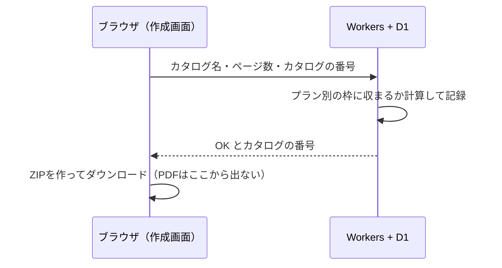

PDFからページめくりのWEBカタログを作るサービスを公開しました。[Web Catalog Studio](https://catalog.orecticdesign.com/?utm_source=zenn&utm_medium=article&utm_campaign=web-catalog-pdf-stays-in-browser) です。作ったカタログはZIPで書き出して、自分のサーバーに置く形です。

書き出したカタログがどう動くかは、デモで確かめられます。

https://catalog.orecticdesign.com/demo/?utm_source=zenn&utm_medium=article&utm_campaign=web-catalog-pdf-stays-in-browser

作るときに最初に決めたのは「**利用者のPDFをサーバーに送らない**」ことでした。ただ、このサービスは有料で、プランごとに「1冊のページ数」と「冊数」の上限があります。そこで、この記事では次の問いを扱います。

> PDFを一度も受け取らないサーバーは、利用者がプランの上限を守っているかをどこまで確かめられるのか

先に結論を書くと、**完全には確かめられません**。この記事では、その穴を分かったうえで受け入れた理由と、ブラウザ側に寄せた処理の中身を、実測値と一緒にまとめます。

:::message
pdf.js でリンクや文字を取り出すコードの細かい書き方は、別に Qiita の記事で扱っています。この記事は「どこで処理するか」という設計の判断が中心です。
:::

## なぜ送らないことにしたのか

カタログにするPDFは、たいてい発売前の商品資料や価格表です。「アップロードした資料はどこに保管されますか」と聞かれる前提で作るより、最初から受け取らない方が説明は1行で済みます。

運営する側にとっても利点があります。PDFや画像を預からなければ、保存容量も転送量もほとんど増えません。消し忘れの事故も起きません。サーバーに残るのは文字の記録だけになります。

## ブラウザの中でやっていること

PDFを読み込むと、作成画面のブラウザの中で次の4つを順に行います。

| 処理 | 使っているもの | 出来上がるもの |
|---|---|---|
| ページを画像にする | pdf.js（Web Worker）＋ canvas | 長い辺2000pxのWebP（使えないブラウザではJPEG）と、一覧用のサムネイル |
| もともとあるリンクを拾う | `page.getAnnotations()` | リンク範囲の**候補**（自動では入れず、利用者が選んで足す） |
| 検索用の文字を取り出す | `page.getTextContent()` | 文字と位置（ページに対する0〜1の割合） |
| ZIPにまとめる | fflate | 公開用フォルダ・編集用データ・説明の1ファイル |

作業の途中のデータはブラウザのIndexedDBに自動で保存します。別のパソコンで続けたいときは、作業ファイル（`.webcatalog`）を書き出して持ち運んでもらいます。

### 日本語PDFの補助データは中に埋め込む

1つ手間がかかったのは、pdf.js の補助データ（CMap・記号フォント・画像デコーダのwasm）です。pdf.js は普段、これを必要になったときにネットワークから取りにいきます。ところが最初はダウンロード版（HTMLファイル1つをダブルクリックで開く形）として作っていたので、`file://` からは取りにいけませんでした。その結果、**フォントを埋め込んでいない日本語PDFの文字が消えました**。

そこで、日本語のCMapなど必要な分だけを1つのZIPにまとめて作成画面に埋め込みました。pdf.js には `BinaryDataFactory` を渡し、取りにいく代わりにそのZIPから返すようにしています。

```ts
const task = pdfjs.getDocument({
  data,
  useWorkerFetch: false,
  BinaryDataFactory: EmbeddedDataFactory, // 埋め込んだZIPから CMap などを返す
});
```

その後サーバー版に切り替えましたが、この形は残しています。PDFを処理している間、補助データを外へ取りにいく通信が起きないからです。

## 実測：何秒かかり、何が取れて、何が送られたか

リポジトリにある試験用のPDF2つを、作成画面と同じ関数（`openPdf` → ページごとに `renderPageImage`・`extractLinks`・`extractText`）に通して測りました。

- 環境：macOS・Chrome 155（8コア）、開発サーバー（127.0.0.1）
- 時間は `performance.now()` で計った1回分の値です（ベンチマークではありません）

| | test-links.pdf | test-jp-fonts.pdf |
|---|---|---|
| ファイルサイズ | 約1.3MB（1,337,364バイト） | 約3KB（2,952バイト） |
| ページ数 | 7 | 1 |
| PDFを開く | 146ms | 2ms |
| 1ページを画像にする | 527〜703ms | 263ms |
| 全部終わるまで | **4,380ms** | **267ms** |
| 出来た画像 | 1333×2000のWebP、1枚146〜296KB | 1413×2000のWebP、57KB |
| 拾えたリンク | **4件**（Webページ2・ページ移動1・メール1） | 0件 |
| 取り出せた文字 | 0件 | **8件**（「ゴシック：新商品カタログ」など） |

時間のほとんどは画像にする処理です。リンクと文字の取り出しは、1ページあたり数ミリ秒で終わっていました。

test-links.pdf の文字が0件なのは、各ページが画像だけで出来ているPDFだからです。このようなPDFは検索に出てこないので、作成画面で「検索用の文字」を手で入れてもらいます。OCRや外部のサービスは使わないと決めています（文字を読むために画像を外へ送ったら、送らない方針と矛盾するからです）。

肝心の通信も確かめました。処理の間に記録されたリクエストは、測るために自分で読み込んだサンプルPDF2つの `GET` だけでした。**サーバーへ送る通信（POSTなど）は0件**です。

もう1つ、測っている途中で気づいたことがあります。`getDocument` に渡した `ArrayBuffer` は、処理のあと `byteLength` が0になっていました。データの写しを作るのではなく、Worker へ渡し切っている（transfer）とみられます。読み込み後に同じバッファをもう一度使うつもりなら、先に写しを作っておく必要があります。

## サーバーに残るもの

サーバーは Cloudflare Workers と D1 で動かしています。カタログについて持っているのは次の値だけです。

| 表 | 持っているもの |
|---|---|
| `catalogs` | カタログの番号・利用者・**カタログ名・ページ数**・作った日時・最後に書き出した日時 |
| `exports` | 書き出した記録（利用者・カタログの番号・カタログ名・ページ数・そのときのプラン・日時） |

PDF・ページの画像・リンクの行き先・取り出した文字は、どれもサーバーには来ません。上限を確かめるときにサーバーが知っているのは、「この利用者が、このページ数のカタログを書き出したいと言っている」ということだけです。

## 限界：上限の確かめはブラウザが申告した数字を信じている

ここが冒頭の問いへの答えです。エクスポートボタンを押すと、作成画面はページ数とカタログの番号をサーバーへ送ります。サーバーはプラン別の枠に収まるかを計算し、よければ記録して「書き出してよい」と返します。ZIPを作るのは、そのあとのブラウザです。



サーバー側で守れているものもあります。たとえば新しいカタログを作るときは、「数える」と「作る」を1つのSQL文で行っています（`INSERT ... SELECT ... WHERE (SELECT COUNT(*) ...) < ?`）。このため、エクスポートボタンを同時に何度押しても、冊数が枠を超えることはありません。

それでも、**ZIPを作っているのは利用者のブラウザで動くコード**です。詳しい人なら、手元でこの確かめを通らないようにできます。また、サーバーはPDFを見ていないので、申告されたページ数が本当かどうかも分かりません。サーバーにできるのは書き出しを記録するところまでで、不正を完全に止めることはできません。

### サーバーでZIPを作れば防げる、けれど

防ぐ方法ははっきりしています。ZIPをサーバーで作ればよいのです。サーバーがページ数を自分で数え、上限を超えるものは作りません。

ただしそのためには、ページの画像（元はPDF）をサーバーへ送らなければなりません。それは「PDFを送らない」という一番の約束を破ることになります。2つを比べて、次の表のように判断しました。

| | サーバーでZIPを作る | ブラウザでZIPを作る（採用） |
|---|---|---|
| 上限を守らせる力 | 強い | 申告を信じる（外せる） |
| 利用者の資料 | サーバーを通る | パソコンから出ない |
| 運営の容量・転送量 | ページ数に比例して増える | ほぼ増えない |
| 300ページのカタログ | アップロードを待つ | 順番に画像にするだけ |

買い切りの個人向けサービスで、確かめを外してまで使う人は多くないと見込みました。その少数のために全員の資料を預かるのは、釣り合わないと判断しています。

### そのほかに受け入れていること

- **OCRはしない**：画像だけのPDFは、検索用の文字を手で入れてもらう
- **データの控えは利用者が持つ**：IndexedDBが消えたら、作業ファイルが無い限り戻せない。サーバーには控えが無い
- **大きなPDFはパソコン次第**：PDFは500MB、画像は1枚50MBまでで止めている。300ページでもメモリを使い切らないよう、1ページずつ画像にしては片付ける

## Claude Codeとの進め方

開発はほとんど Claude Code と一緒に進めました。このように「方針と矛盾するので採らなかった案」が多い製品では、決めたことを毎回コードより先に読ませるのが効きました。たとえば「サーバーでZIPを作れば防げるが、PDFを送らない方針と矛盾する」という一文を判断の記録に残しておくと、上限の確かめの話になるたびに同じ案が蒸し返されなくなります。README にも、上限の確かめは完全には防げない、と注意書きで残しています。

## まとめ

- PDFをサーバーに送らなくても、画像にする・リンクを拾う・文字を取り出す・ZIPにまとめる、まではブラウザでできる。今回のサンプル（7ページ）では4.4秒で、サーバーへ送る通信は0件だった
- `file://` や通信が無い状況も考えるなら、pdf.js の CMap などは埋め込み、`BinaryDataFactory` から渡す
- 代わりに、上限の確かめは**ブラウザが申告する数字を信じる**ことになる。サーバーは記録はできても、止めきることはできない
- 防ぎたければZIPをサーバーで作るしかない。それは「預からない」と引き換えになるので、どちらを取るかを決めて、決めた理由を記録に残しておく

実際の動きは [デモのカタログ](https://catalog.orecticdesign.com/demo/?utm_source=zenn&utm_medium=article&utm_campaign=web-catalog-pdf-stays-in-browser) でめくって確かめられます。

---

**筆者について：** Web制作・SEOツール開発を行うフリーランス。[CodeQuest.work](https://codequest.work/?utm_source=zenn&utm_medium=article&utm_campaign=web-catalog-pdf-stays-in-browser) で活動中。
[Direbase（ディレベース）](https://seo.codequest.work/?utm_source=zenn&utm_medium=article&utm_campaign=web-catalog-pdf-stays-in-browser) — ディレクターも使っているSEO診断ツールを公開中。
